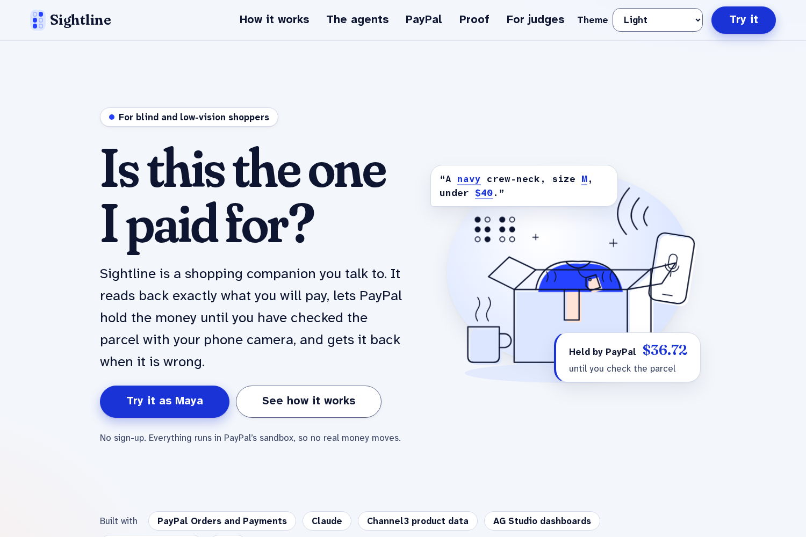
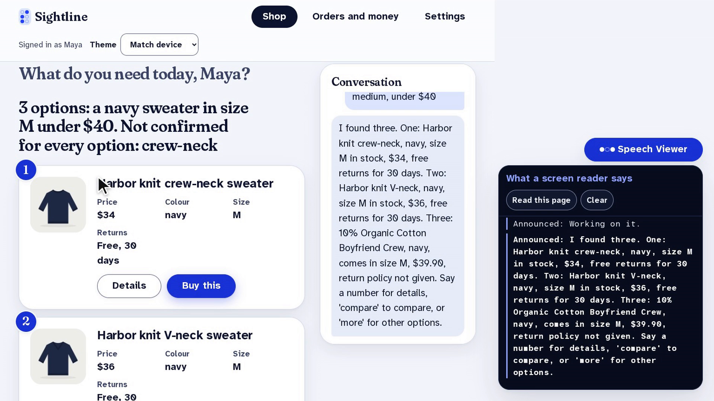
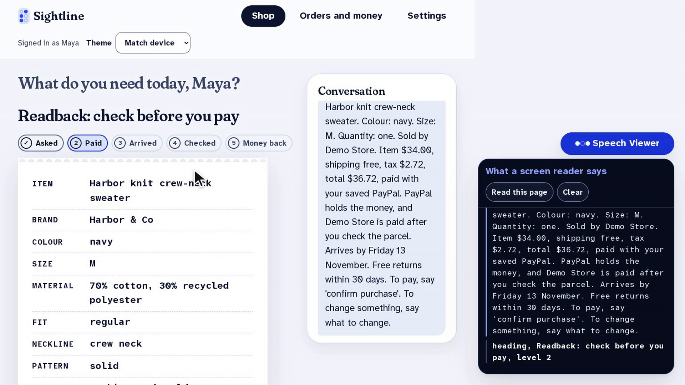
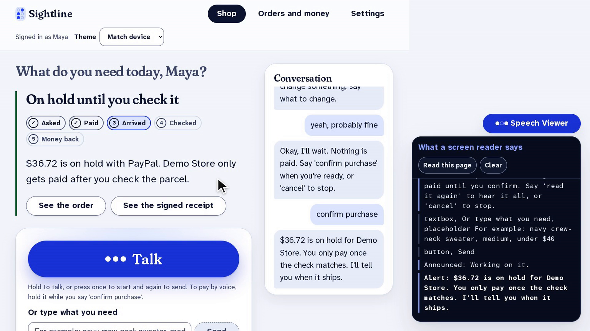
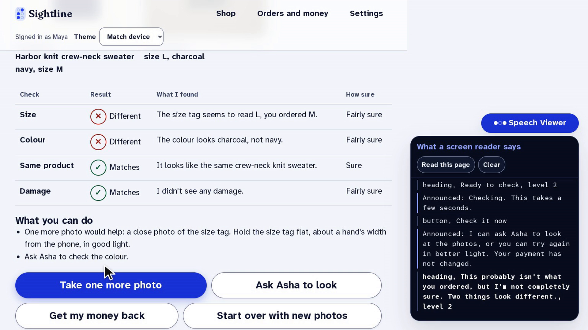
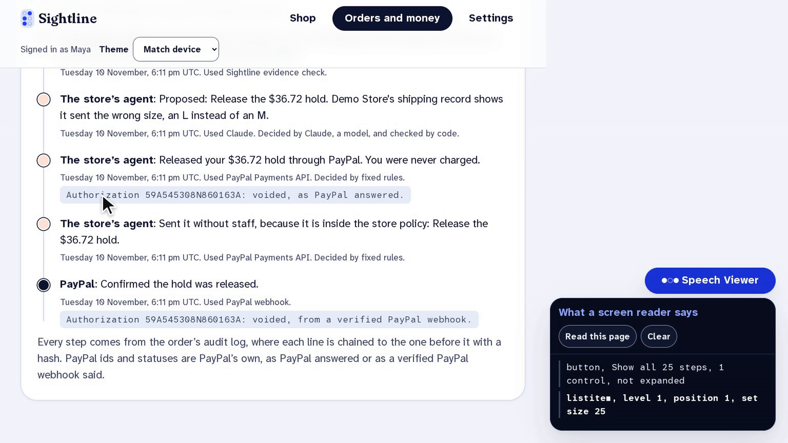
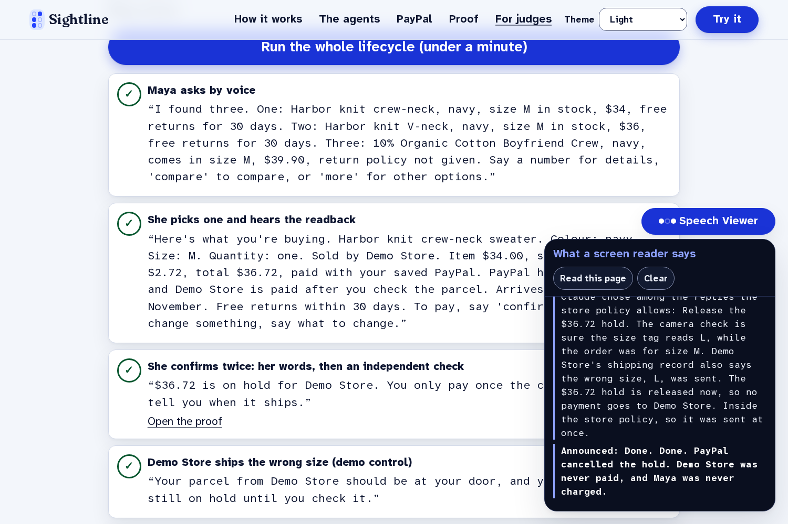
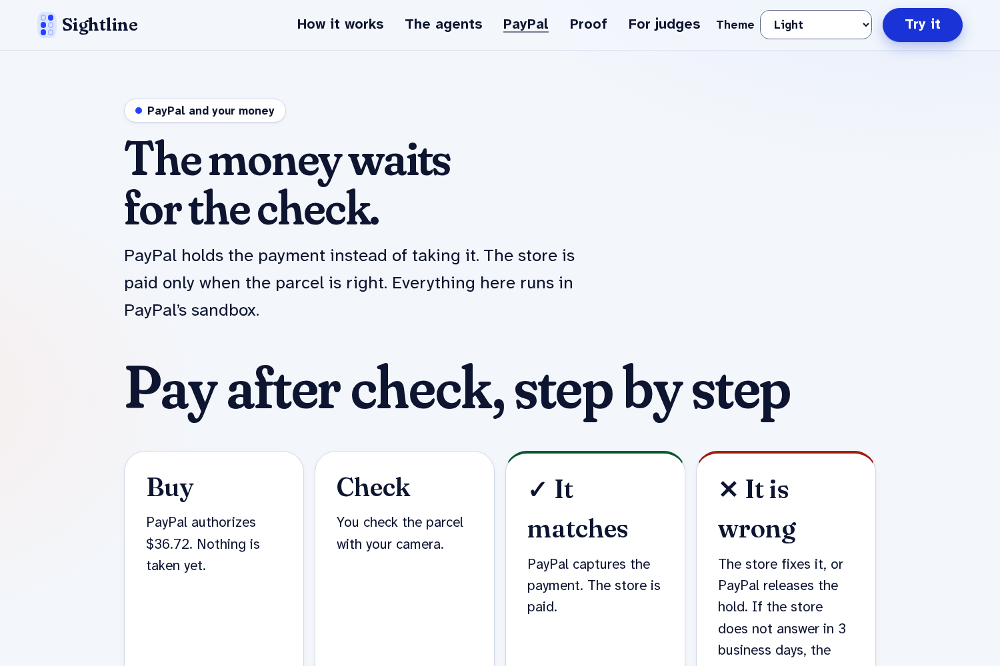
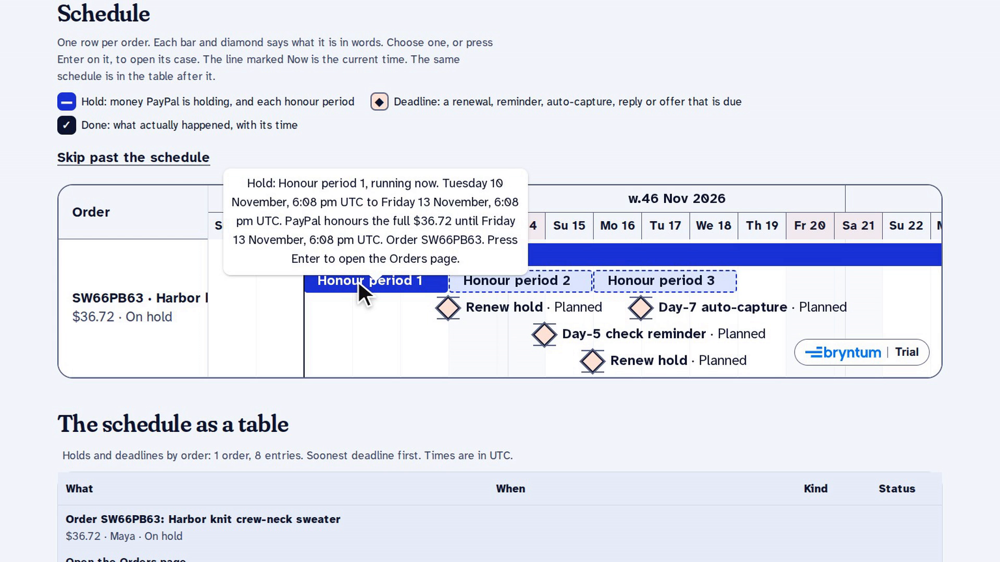
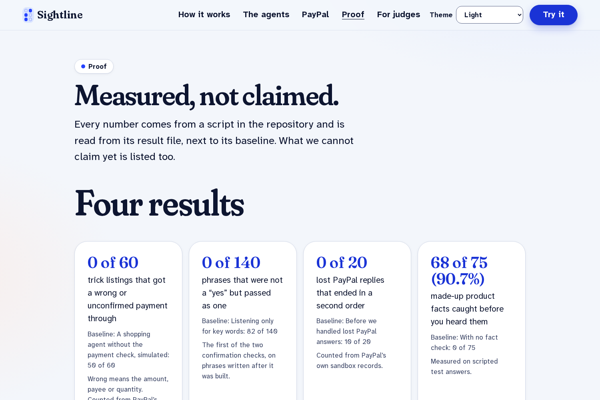

## Inspiration

A parcel arrives. You paid for a navy sweater, size medium. Is this it?

If you can't see, that question has no easy answer. Blind and low-vision people can already shop online with a screen reader, slowly. What still breaks is **after checkout**: knowing that what arrived is what you paid for, and getting your money back when it isn't. Until now, knowing meant waiting for someone else to look.

- 49% of disabled shoppers who needed to return something had problems doing it, and one in seven disabled consumers couldn't use the retailer's suggested return method (Which? with RIDC).
- In a CHI 2026 study of 12 blind and low-vision people shopping with an AI agent, participants couldn't verify what the agent told them and didn't trust it with payment.

So we asked a simple question: **what if the money waited until the parcel was checked?** Sightline makes the whole money lifecycle something a blind person can do alone, with PayPal underneath it and an agent that can be checked at every step.

## What it does

**1. Ask by voice.** Talk or type: *"A navy crew-neck sweater, medium, under forty dollars."* A Claude shopping agent searches real product data, compares, and gives three options at most, each with colour, size, price and returns. Every line it speaks is checked against the listing first. If the listing doesn't say something, you hear "the listing doesn't say", never a guess.

**2. Hear exactly what you'll pay.** Before any money moves, a fixed template (not the AI) reads back the item, colour, size, seller, total, delivery date and return window. Paying needs two independent keys: your own words while you hold the Talk button, and a separate model check. "Yeah, probably fine" is not a yes, so nothing is paid.

**3. PayPal holds the money.** The payment is a PayPal **authorization**, not a charge. The store is paid only after your check passes.

**4. Check the parcel with your phone.** The camera talks you into frame and takes the photos: the item, the size tag, any damage. You hear a plain answer and how sure it is, in words. A "sure" mismatch needs two independent looks. When it isn't sure, it asks for one specific extra photo instead of guessing.

**5. Get your money back, agent to agent.** Say "it's wrong". Your agent signs an evidence pack and sends it to the store. The **store's own agent** checks the signature and proposes a fix within the store's rules: a replacement, the hold released, or part of the price back. Code computes every amount; the model only picks and explains. You answer with two presses, and PayPal voids the hold. **Maya was never charged.**

**For judges:** one button on `/judge` runs the whole lifecycle live against the PayPal sandbox in under a minute, with the **Speech Viewer** showing what a screen reader says at each step.

## How we built it

**PayPal, end to end (sandbox)**
- **Orders v2** with `intent: AUTHORIZE`, created from the confirmed readback. The `PayPal-Request-Id` is derived from the readback, so a retry or a second "yes" returns the same order instead of charging twice.
- **Payments v2**: authorize at purchase, capture on a match, void on a wrong item, partial capture with `final_capture` to keep an item for less, refunds, and reauthorization inside PayPal's 29 days.
- **Vault**: after the first purchase, later ones are paid by voice alone.
- **JS SDK v6** for the first approval, **package tracking** on the order, **webhooks** verified by signature, and **Disputes** on the store's case desk.

**AI (Claude)**
- **Claude Haiku 5.5**: the tool-using shopping agent (11 tools, capped, with a fixed-rules fallback) and the second confirmation key, which can only agree or veto.
- **Claude Opus 5.5**: reads the size tag, product and damage in photos, writes the case summary, and runs the store's agent.
- **Model output never moves money.** Amounts, payees and confirmations come from frozen listing snapshots, the readback and an eight-guard payment gate that signs a receipt for every decision.

**For stores:** a case desk with the signed evidence, a store agent that settles clear cases inside the store's own rules, AG Studio dashboards, and a Bryntum timeline of every hold and deadline.

**Stack:** TypeScript, Next.js, React, PostgreSQL, a Python vision service, Channel3 product data, an MCP server so other agents can use the readback and the delivery check, hosted on AWS.

**Accessibility is the product.** Every update goes through one announcer, focus moves only when it should, everything works by keyboard, there's a high-contrast low-vision mode, and no status is shown by colour alone. Every page has 0 axe violations in light, dark and high-contrast themes on phone and desktop.

## Measured, not claimed

Every number comes from a script in the repository, next to a baseline. The payment results are counted from **PayPal's own sandbox records**, not our logs:

| What we measured | Sightline | Baseline |
|---|---|---|
| Trick listings that got a wrong payment through (PayPal sandbox) | **0 of 60** | naive agent, simulated: 50 of 60 |
| Lost PayPal replies that ended in a second order (PayPal sandbox) | **0 of 20** | before our fix: 10 of 20 |
| Phrases that weren't a "yes" but passed as one | **0 of 140** | keyword matching: 82 of 140 |
| Matching parcels wrongly called a mismatch | **1 of 210** | CLIP image matching: 189 of 210 |
| Invented product facts caught before speaking | **68 of 75** | no check: 0 of 75 |

With small samples, zero failures doesn't mean a zero rate, so every count is reported with a 95% Wilson interval:

$$
\frac{\hat p + \frac{z^2}{2n} \pm z\sqrt{\frac{\hat p(1-\hat p)}{n} + \frac{z^2}{4n^2}}}{1 + \frac{z^2}{n}}, \qquad z = 1.96
$$

So **0 of 60** breaches means the true rate is at most about **6%**, not "never".

**We also publish where it's weak:** colour mismatches are caught 0 of 53 times on our synthetic test photos, and the check says "not sure" on most pairs rather than guess.

## Challenges we ran into

- **Buyers can't open PayPal disputes by API** outside approved partners. So we made the common case need no dispute at all: the money simply waits for the check.
- **A lost PayPal reply nearly caused double charges.** Telling the buyer "nothing was charged" after a timeout led to a second order. Our duplicate test found it; now the hold is kept, repeats are blocked, and the original request is reconciled with the same request id.
- **PayPal rejected product images without a file extension**, which silently blocked every purchase of a live-catalogue product until live sandbox runs caught it.
- **A strict "two looks" rule made the camera say "not sure" more often.** Asking for one targeted extra photo won most of that back without new false alarms.

## Accomplishments that we're proud of

- The full lifecycle runs live against the PayPal sandbox from one button, and it finished **10 runs out of 10** in a row.
- The payment safety numbers come from **PayPal's own records**.
- **0 accessibility violations** on every page, in three themes.
- A Speech Viewer that lets a sighted person follow exactly what a blind shopper hears.

## What we learned

Accessibility and payment safety pull the same way. A readback a blind person can trust is also a contract the payment gate can enforce, and an agent whose every step is shown is one people can check.

## What's next

- Sessions with blind and low-vision testers.
- A browser companion that reads any store's product page aloud and hands the purchase to Sightline where pay-after-check is offered.
- A better colour check, Hindi voice and readback, and a phone line.
- A program for stores to offer pay after check.

**Built for blind and low-vision shoppers.** Maya is a persona; all payments run on the PayPal sandbox.
